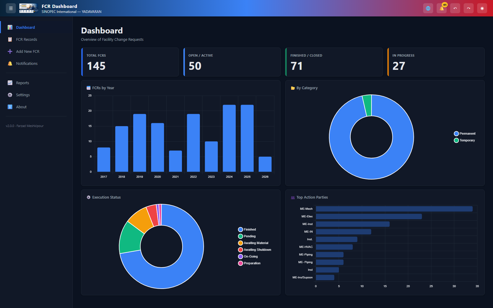
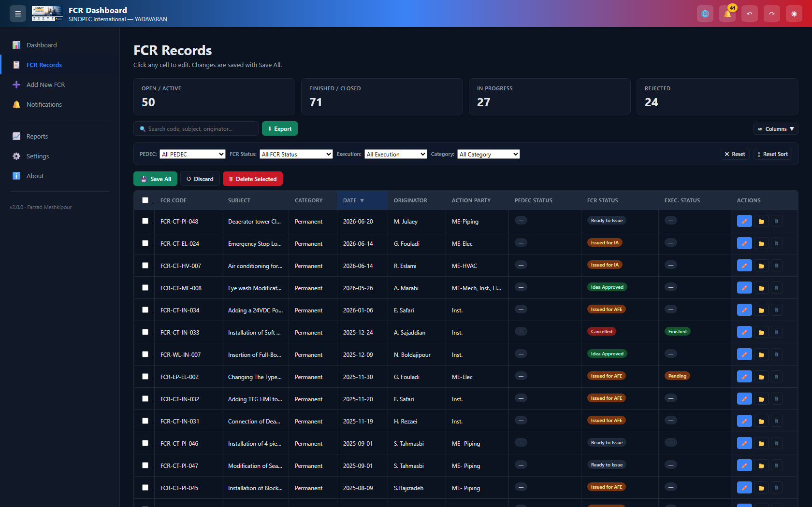
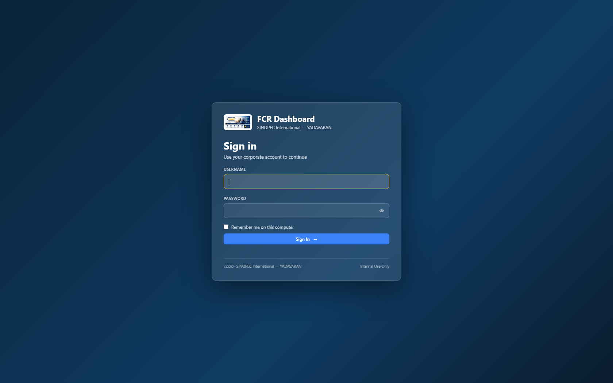

# FCR Dashboard

Offline, desktop-style web application for managing Field Change Requests (FCRs) at
**SINOPEC International - YADAVARAN**. A FastAPI backend serves a vanilla-JavaScript
dashboard, the launcher opens it in Microsoft Edge app mode, and all data stays in a
portable SQLite database next to the executable.

**Version 2.0.0** | Windows 10 / 11 | Python 3.11+ | No internet connection required



*Dashboard — live counters and charts built from the SQLite database.*



*FCR Records — inline editing, filters, sortable columns and row actions.*

## Contents

- [What's new in 2.0.0](#whats-new-in-200)
- [Features](#features)
- [Tech stack](#tech-stack)
- [Project structure](#project-structure)
- [Getting started](#getting-started)
- [Configuration](#configuration)
- [Data model and FCR code scheme](#data-model-and-fcr-code-scheme)
- [Excel export](#excel-export)
- [Backups](#backups)
- [Keyboard shortcuts](#keyboard-shortcuts)
- [Troubleshooting](#troubleshooting)
- [Development and tests](#development-and-tests)
- [CI/CD](#cicd)
- [فارسی](#فارسی)
- [License](#license)
- [Author](#author)

## What's new in 2.0.0

- **Sign-in screen** in front of the dashboard (demo credentials `demo` / `demo`).
  This is a visual gate for demo presentations, **not** a security boundary; real
  authentication will come from ERMS single sign-on after the .NET migration.
- Application version has a single source of truth (`APP_VERSION` in `app/core/config.py`).
- Automatic database backups, with backup copies taken through the SQLite backup API
  so a copy stays consistent even while the database is in WAL mode.
- FCR codes are validated and normalized (`FCR-<AREA>-<DEPT>-<NNN>`) before they are saved.
- Dashboard status counters and status filters share the same grouping rules.
- Undo/redo works locally in the table until records are saved with Save All.
- Charts are responsive and readable in dark mode.
- Security headers on every response and CORS restricted to localhost.
- Launching the exe no longer flashes console windows: child processes inherit no
  console and the Edge window is monitored without spawning PowerShell.
- Regression test suite (pytest) runs in CI before every build.

## Features

### Sign-in



- Corporate-style sign-in card: username, password (with show/hide), remember-me.
- Wrong or blank credentials show an inline error and keep the user on the screen.
- A successful sign-in is remembered for the browser session; "Remember me" keeps it
  on the machine. The dashboard data is pre-loaded behind the splash so entering the
  dashboard is instantaneous.
- **Demo credentials: `demo` / `demo`.**

### Dashboard and analytics

- Dashboard with four charts built from live FCR statistics.
- KPI counters for each status group; clicking a counter filters the table to exactly
  the rows it counted.
- Charts follow the light/dark theme and resize with the window.

### FCR records

- Records table with inline cell editing, **Save All** and **Discard**.
- Bulk delete of selected rows.
- Undo/redo of table edits (local until Save All).
- Column visibility presets.
- Filters for PEDEC status, FCR status, execution status and category.
- Free-text search and sortable columns.
- **Add New FCR** form with validated code and auto-numbered rows.
- FCR codes are normalized (trimmed, upper-cased, whitespace removed) and checked
  against the allowed area and department codes.

### Notifications and reports

- PEDEC follow-up notifications: records issued to PEDEC whose review date is within
  the configured alert window (`pedec_alert_days`).
- Reports page with summary figures and charts.

### Excel export

- Plain Excel export of the current FCR data.
- Export with charts: a workbook with a data sheet plus a `Charts & Summary` sheet.
- Optional automatic export on a configurable interval.

### Backups

- Manual backup button and automatic scheduled backups.
- Backup listing with date and size, kept in the configured backup folder.
- Restoring a backup: close the application and copy the chosen backup file over
  `fcr_database.db` in the application folder.

### Settings

- Company name, attachment root, backup folder and export folder.
- Dark mode and light mode.
- Language: English or Chinese (中文).
- PEDEC alert window in days.
- Department code labels.

### Folder automation

- Maps an FCR code to its archive folder, for example
  `FCR-CT-PI-046` → `X:\1-DC\CTEP\PI\FCR-CT-PI-046`.
- Opens the folder in Explorer, or creates it when missing.

## Tech stack

| Layer         | Technology                                                        |
| ------------- | ----------------------------------------------------------------- |
| Backend       | Python 3.11+, FastAPI 0.115.0, Uvicorn 0.30.6 (standard extras)    |
| Data model    | Pydantic 2.9.2                                                    |
| Database      | SQLite in WAL mode, portable file `fcr_database.db`                |
| Frontend      | HTML5, CSS3, vanilla JavaScript, no framework and no build step    |
| Charts        | Chart.js bundled locally in `static/chart.min.js`                  |
| Excel export  | openpyxl 3.1.5 (plain and chart exports)                           |
| Desktop shell | Microsoft Edge `--app=` mode (no WebView2, no pywebview)           |
| Packaging     | PyInstaller 6.10.0, onedir bundle                                  |
| Tests         | pytest 8+, FastAPI `TestClient` through httpx                      |
| CI/CD         | GitHub Actions on `windows-latest`                                 |

## Project structure

```text
FCR-dashboard/
├── main.py                 FastAPI entry point (wires routers, middleware, static UI)
├── app/                    Backend package: core (config, db), routers, services, models
├── launcher.py             Desktop entry point: local uvicorn server + Edge app mode
├── migrate_db.py           Schema migration helper
├── requirements.txt        Runtime dependencies
├── requirements-dev.txt    Development and test dependencies
├── FCR_Dashboard.spec      PyInstaller build specification
├── version_info.txt        Windows version resource (2.0.0.0)
├── BUILD_EXE.bat           Build the Windows executable
├── START_SERVER.bat        Run the development server (Windows)
├── run_server.sh           Run the server on Linux / expose it to the LAN
├── settings.json           Default configuration template
├── fcr_database.db         Portable SQLite database with seed data
├── static/
│   ├── index.html          Application shell
│   ├── script.js           UI logic, table editing, charts, i18n
│   ├── style.css           Light and dark theme
│   ├── chart.min.js        Bundled Chart.js (fully offline)
│   ├── logo.png
│   └── icon.ico            Executable icon
├── tests/
│   └── test_api.py         API regression tests (temporary database copy)
├── .github/
│   └── workflows/
│       └── main.yml        CI: tests, Windows build, artifact and release
├── .gitignore
├── LICENSE                 Apache License 2.0
└── README.md
```

At runtime the application also creates `logs/app.log`, `backups/*.db`,
`exports/*.xlsx`, `settings.json` and `fcr_database.db` beside the executable
(or in the repository root when running from source).

## Getting started

### Requirements

- Windows 10 or 11 (for the desktop build) **or** any Linux distribution (for
  `run_server.sh`).
- Python 3.11 or newer for running from source (CI uses Python 3.12).
- Microsoft Edge (pre-installed on Windows 10 and 11) for app-mode display.
- Access to the attachment archive root (default `X:\1-DC`) for folder automation;
  this is optional and configurable in `settings.json`.

### Option A - run from source

1. Double-click `START_SERVER.bat`. The script creates a virtual environment,
   installs `requirements.txt`, starts uvicorn on `http://127.0.0.1:8000` and opens
   the dashboard in the default browser.
2. To launch the Edge app-mode window instead, activate the environment and run the
   launcher: `python launcher.py`.

Manual setup:

```bat
python -m venv venv
venv\Scripts\activate
pip install -r requirements.txt
uvicorn main:app --host 127.0.0.1 --port 8000 --reload
```

Useful URLs while developing:

- Application: `http://127.0.0.1:8000`
- Interactive API documentation: `http://127.0.0.1:8000/api/docs`
- Health check: `http://127.0.0.1:8000/api/health`

### Option B - build the Windows executable

1. Ensure Python 3.11+ is on `PATH`.
2. Double-click `BUILD_EXE.bat`.
   - Verifies Python, `FCR_Dashboard.spec` and `static/`.
   - Creates and activates `venv`, installs `requirements.txt`.
   - Cleans `build/` and `dist/` and runs
     `pyinstaller FCR_Dashboard.spec --clean --noconfirm`.
   - Copies `fcr_database.db`, writes a `README.txt` deployment note and opens the
     output folder in Explorer.
3. Distribute the **whole** `dist\FCR_Dashboard\` folder, not only the `.exe`.

The executable is `dist\FCR_Dashboard\FCR_Dashboard.exe`. Its version resource
(2.0.0.0) comes from `version_info.txt`, and the application icon from
`static/icon.ico`.

### Option C - run on a Linux server (browser access from a phone)

`run_server.sh` sets up a virtual environment, installs the dependencies and starts
uvicorn. It works on any Linux distribution with `python3` (3.10+), `python3-venv`
and `bash`.

```bash
# On Debian/Ubuntu, once:
apt install -y python3 python3-venv python3-pip unzip

# Put the extracted repository at /root/FCR dashboard, then:
cd /root/FCR\ dashboard
chmod +x run_server.sh

./run_server.sh                 # local only  → http://127.0.0.1:8000
./run_server.sh --public        # open to your network → http://<server-ip>:8000
./run_server.sh --public --port 8080
./run_server.sh --dir /opt/fcr --help
```

Open `http://<server-ip>:8000/` in the browser of your phone, sign in with
`demo` / `demo` and use the dashboard exactly like the desktop build.

If the page does not load from another device, allow the port through the firewall:

```bash
ufw allow 8000/tcp                                     # Ubuntu/Debian
firewall-cmd --add-port=8000/tcp --permanent --reload   # RHEL/Fedora
```

> **Security warning.** `--public` binds the app to `0.0.0.0`, which exposes the full
> database and every write endpoint to anyone who can reach the port. The sign-in
> screen is a visual gate (`demo`/`demo`) and **is not real authentication**. Use
> `--public` only on a trusted network, or put the app behind a reverse proxy with
> proper authentication.
>
> The app always runs with a **single** worker because it keeps a SQLite database in
> WAL mode plus an in-process backup/export scheduler; multiple workers would start
> duplicate schedulers and increase SQLite write contention.

## Configuration

`settings.json` is a UTF-8 JSON file stored beside the executable. Missing keys fall
back to built-in defaults, and the application recreates the file with defaults when
it is missing or unreadable.

| Key                         | Default                                  | Description                                                             |
| --------------------------- | ---------------------------------------- | ----------------------------------------------------------------------- |
| `company_name`              | `SINOPEC International - YADAVARAN`      | Company name shown in the UI and reports.                               |
| `attachment_root`           | `X:\1-DC`                                | Root of the attachment archive used by folder automation.               |
| `backup_location`           | `backups`                                | Backup folder; relative paths resolve against the application folder.   |
| `auto_backup_enabled`       | `true`                                   | Enables scheduled database backups.                                     |
| `auto_backup_interval_days` | `1`                                      | Minimum number of days between automatic backups.                       |
| `last_auto_backup`          | `""`                                     | Timestamp of the last automatic backup; maintained by the application.  |
| `auto_export_enabled`       | `false`                                  | Enables the automatic Excel export.                                     |
| `auto_export_location`      | `exports`                                | Output folder for automatic Excel exports.                              |
| `auto_export_interval_days` | `2`                                      | Minimum number of days between automatic exports.                       |
| `last_auto_export`          | `""`                                     | Timestamp of the last automatic export; maintained by the application.  |
| `pedec_alert_days`          | `14`                                     | Review window, in days, for PEDEC follow-up notifications.              |
| `dark_mode`                 | `false`                                  | Starts the UI in dark mode when `true`.                                 |
| `language`                  | `en`                                     | Interface language: `en` (English) or `zh` (Chinese).                   |
| `dept_codes`                | see FCR code scheme                      | Mapping of department code to department name.                          |
| `app_version`               | `2.0.0`                                  | Read-only, injected by the API from `APP_VERSION`.                      |

Settings can also be changed from the Settings page. Relative paths are resolved
against the application folder.

## Data model and FCR code scheme

The database is a single SQLite file, `fcr_database.db`, opened in WAL mode. The
schema is created automatically on first run; `migrate_db.py` is included for schema
migrations.

### `fcr` table

| Column             | Description                                        |
| ------------------ | -------------------------------------------------- |
| `row_num`          | Sequence number shown as "Row"; auto-numbered       |
| `fcr_subject`      | Short subject of the FCR                            |
| `category`         | FCR category                                        |
| `fcr_code`         | FCR code, `FCR-<AREA>-<DEPT>-<NNN>`                 |
| `date`             | Issue date                                          |
| `review_date`      | Review / target date                                |
| `originator`       | Originating party                                   |
| `action_party`     | Responsible action party                            |
| `level`            | Severity / level                                    |
| `session_code`     | Session code                                        |
| `pedec_status`     | PEDEC status                                        |
| `fcr_status`       | FCR status                                          |
| `execution_status` | Execution status                                    |
| `closed_date`      | Closing date                                        |
| `tr`               | TR reference                                        |
| `next_action_by`   | Party responsible for the next action               |
| `arch_loc`         | Archive location                                    |
| `last_update`      | Last update information                             |
| `remarks`          | Free-text remarks                                   |
| `created_at`       | Creation timestamp, set by the database             |
| `updated_at`       | Last modification timestamp, set by the database    |

The `import_log` table records external imports (`filename`, `row_count`,
`imported_at`). A `meta` table stores the schema version.

### FCR code scheme

Format: `FCR-<AREA>-<DEPT>-<NNN>`, for example `FCR-CT-PI-046`.

| AREA | Archive folder under `attachment_root` |
| ---- | -------------------------------------- |
| `CT` | `CTEP`                                 |
| `EP` | `EPL`                                  |
| `FM` | `FILMS`                                |
| `WL` | `WELLS`                                |
| `MS` | `Miscellaneous`                        |

| DEPT | Department | DEPT | Department |
| ---- | ---------- | ---- | ---------- |
| `PI` | Piping     | `ME` | Mechanical |
| `IN` | Instrument | `EL` | Electrical |
| `HV` | HVAC       | `CR` | Corrosion  |
| `PR` | Process    | `CV` | Civil      |

The area folder and department code are combined with `attachment_root` to locate
the record folder: `FCR-CT-PI-046` maps to `X:\1-DC\CTEP\PI\FCR-CT-PI-046`.
Codes are upper-cased and stripped of whitespace; malformed codes or unknown area /
department codes are rejected with HTTP 400.

## Excel export

Two export options are available from the Reports / Export area:

- **Plain export** - the FCR data as an Excel worksheet.
- **Export with charts** - a workbook with the FCR data sheet plus a
  `Charts & Summary` sheet containing status, execution and category charts and
  summary tables.

Files are streamed as `.xlsx` downloads. When automatic export is enabled
(`auto_export_enabled`), the scheduler writes `FCR_AutoExport_<timestamp>.xlsx`
into `auto_export_location` at most once per `auto_export_interval_days`.

## Backups

- Backups are written to `backup_location` as
  `fcr_database_backup_<YYYYmmdd_HHMMSS>.db`.
- Copies are made with the SQLite backup API, so they are consistent even while the
  application is running with WAL enabled.
- Automatic backups run at most once per `auto_backup_interval_days` (default: daily)
  and are enabled by default.
- The backup list shows the available backups with their timestamps; only the most
  recent backups are retained, older files are pruned automatically.
- To restore, close the application, replace `fcr_database.db` with the chosen
  backup file, and start the application again. If `fcr_database.db-wal` and
  `fcr_database.db-shm` are present from an unclean shutdown, remove them first.

## Keyboard shortcuts

| Shortcut                     | Action                                   |
| ---------------------------- | ---------------------------------------- |
| `Ctrl+Z`                     | Undo the last table edit                 |
| `Ctrl+Y` / `Ctrl+Shift+Z`    | Redo the last undone edit                |
| `Ctrl+S`                     | Save All changes                         |
| `Esc`                        | Close the open modal / dialog            |
| `Enter`                      | Open the editor for the selected row     |

## Troubleshooting

### The `X:` drive is not available

Folder automation uses `attachment_root` (default `X:\1-DC`). If the drive is not
mapped on this machine, opening or creating an FCR folder fails while the rest of
the application keeps working. Map the network drive, or change `attachment_root` in
Settings to an accessible path such as `C:\FCR_Attachments`.

### Port 8000 is already in use

The launcher scans ports 8000-8019 and uses the first free port, then opens Edge at
that address. When starting uvicorn manually, choose another port explicitly:

```bat
uvicorn main:app --host 127.0.0.1 --port 8080
```

### Microsoft Edge is missing

The launcher shows a message box and exits when Edge cannot be found. Install
Microsoft Edge from <https://www.microsoft.com/edge> and start the application again.

### `pip install` fails on an offline machine

Prepare the wheels on a connected machine and install from the local folder:

```bat
pip download -r requirements.txt -d wheels
pip install --no-index --find-links wheels -r requirements.txt
```

The application itself needs no internet connection at runtime: Chart.js is bundled
in `static/chart.min.js` and all data is stored locally.

### Windows SmartScreen blocks the executable

`FCR_Dashboard.exe` is not code-signed, so SmartScreen may warn on first launch.
Choose "More info" and then "Run anyway", or unblock the file from its Properties
dialog. For managed deployment, distribute the ZIP through an approved location and
whitelist it in the organization's security policy.

### Logs

Startup and runtime messages are written to `logs/app.log` beside the executable.
Check this file first when the application fails to start.

If the launcher cannot start the built-in server it shows a message box and writes the
full traceback to `logs/launcher-error.log`. Send that file when reporting a startup
problem — it contains the exact Python error.

## Development and tests

Install the development dependencies and run the test suite:

```bat
pip install -r requirements-dev.txt
python -m pytest tests -q
```

The tests use FastAPI's `TestClient` (through `httpx`) and run without network access.
They operate on a temporary copy of the SQLite database, so the repository database
is never modified.

Code layout:

- `main.py` - FastAPI entry point; backend logic lives in the `app/` package (routers, services, models, core config/db).
- `launcher.py` - finds a free port, runs uvicorn, opens Edge in app mode.
- `static/` - the frontend; no build step, edit and reload the page.
- `tests/test_api.py` - API regression tests.

## CI/CD

`.github/workflows/main.yml` defines two jobs on `windows-latest`:

1. **Test** - runs on pushes to `main`, pull requests, tags (`v*`) and manual
   dispatches. Installs Python 3.12 with pip caching, installs
   `requirements-dev.txt` and runs `python -m pytest tests -q`.
2. **Build EXE** - runs after the tests pass, but not for pull requests. Installs
   the runtime dependencies and PyInstaller, builds
   `FCR_Dashboard.spec` with `--clean --noconfirm`, stages `fcr_database.db` and
   `static/` in `dist\FCR_Dashboard`, packages `FCR_Dashboard.zip`, and uploads it
   as a workflow artifact (retention: 14 days).
   - On a `v*` tag, a GitHub release is created for that tag with the ZIP attached.
   - On a `main` branch build, the previous `latest` release is replaced with a new
     `latest` release pointing at the most recent build.

## فارسی

**داشبورد FCR** یک برنامه وب دسکتاپی و کاملاً آفلاین برای مدیریت فرم‌های درخواست
تغییر (FCR) در شرکت ساینوپک بین‌الملل — یادواران است. رابط کاربری با FastAPI و
JavaScript خالص ساخته شده و در حالت اپلیکیشن مرورگر Microsoft Edge باز می‌شود؛ همه
داده‌ها در یک پایگاه داده SQLite کنار فایل اجرایی ذخیره می‌شوند.

- داشبورد با چهار نمودار و شمارنده‌های وضعیت
- جدول FCR با ویرایش درجا، ذخیره/لغو، حذف گروهی، واگرد/ازنو، فیلترها، جستجو و مرتب‌سازی
- فرم افزودن FCR جدید و اعتبارسنجی کدهای `FCR-<AREA>-<DEPT>-<NNN>`
- پیگیری PEDEC، صفحه گزارش‌ها و خروجی اکسل همراه با نمودار
- پشتیبانی از دو زبان انگلیسی و چینی، تم روشن و تاریک
- پشتیبان‌گیری خودکار از پایگاه داده و زمان‌بندی خروجی اکسل
- اجرای کاملاً آفلاین، بدون نیاز به اینترنت

**اجرا:** `START_SERVER.bat` را اجرا کنید یا برای ساخت نسخه اجرایی
`BUILD_EXE.bat` را اجرا کنید. خروجی در پوشه `dist\FCR_Dashboard\` ساخته می‌شود.

**آزمون‌ها:** `pip install -r requirements-dev.txt` و سپس
`python -m pytest tests -q`

**ارتباط:** فرزاد مشکی‌پور — `f.meshkipour@petroyada.com`

## License

This project is distributed under the Apache License 2.0; see [LICENSE](LICENSE).
It is maintained for internal use by SINOPEC International - YADAVARAN. Confirm
distribution terms with the project owner before sharing outside the organization.

## Author

**Farzad Meshkipour**
SINOPEC International - YADAVARAN
Email: [f.meshkipour@petroyada.com](mailto:f.meshkipour@petroyada.com)
